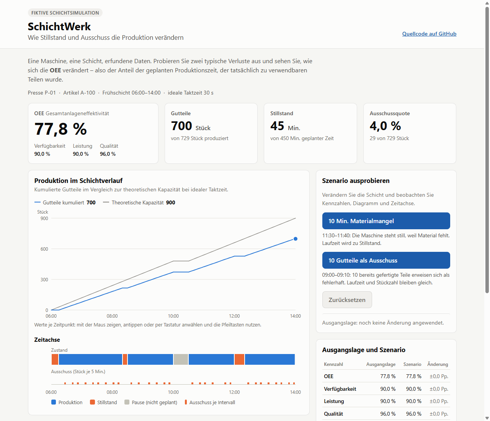
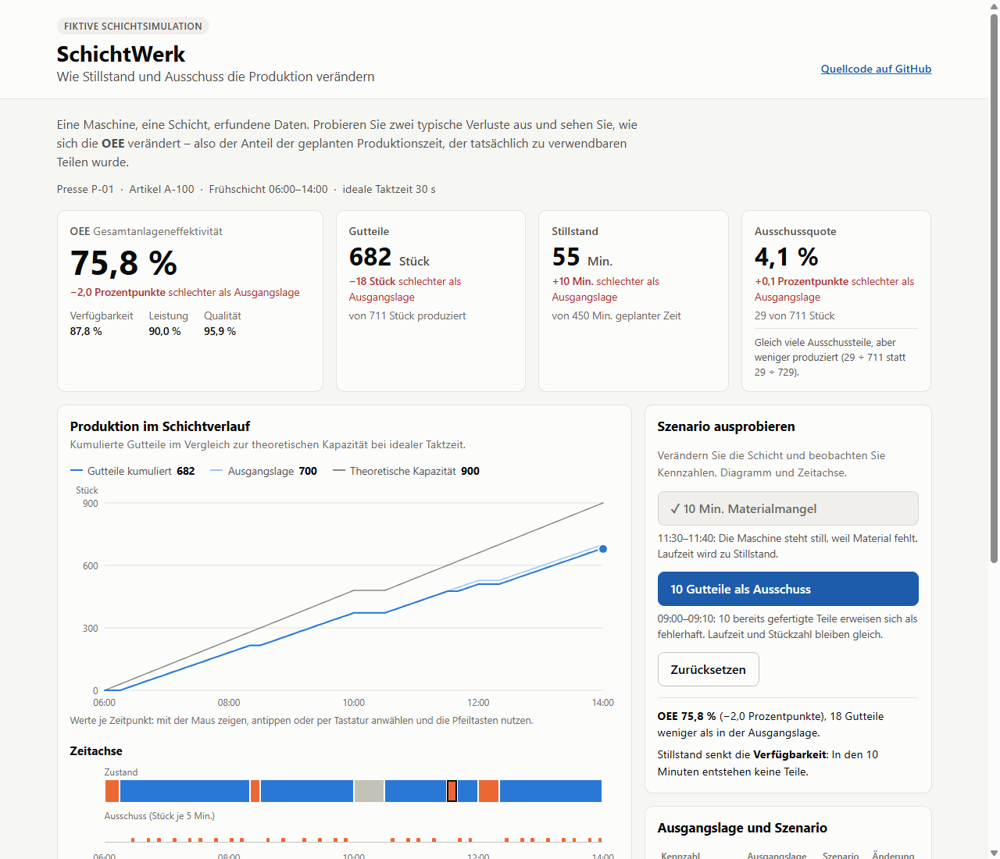

# SchichtWerk — Produktionsverluste verstehen

**[▶ Live-Demo — ohne Anmeldung](https://jerwelz.github.io/SchichtWerk/)** · läuft direkt im Browser, keine Installation, keine Registrierung

Eine kleine, interaktive Simulation einer **fiktiven Produktionsschicht**: Besucher lösen Stillstand oder Ausschuss aus und sehen sofort, wie sich Ausbringung und **OEE** (Gesamtanlageneffektivität) verändern. Die gesamte Fachlogik ist in **C#** geschrieben und läuft mit **Blazor WebAssembly** im Browser.



## Worum es geht

Eine reine Stückzahl sagt nicht, *warum* weniger produziert wurde: wegen Stillstand, langsamerem Arbeiten oder Ausschuss? SchichtWerk verbindet diese Ursachen mit einem nachvollziehbaren Ergebnis. Das Projekt ist ein Lern- und Portfolio-Projekt im Rahmen meiner Bewerbung als Fachinformatiker für Anwendungsentwicklung. Es ist **keine Industriesoftware**: Alle Daten sind erfunden, es gibt keine Anbindung an Maschinen, SAP oder andere Systeme.

## In 30 Sekunden ausprobieren

1. [Demo öffnen](https://jerwelz.github.io/SchichtWerk/): Die Ausgangslage zeigt OEE 77,8 %, 700 Gutteile und 45 Minuten Stillstand.
2. **„10 Min. Materialmangel“** klicken: Die Maschine steht 11:30–11:40 still. OEE fällt auf 75,8 % (−2,0 Prozentpunkte), 18 Gutteile fehlen, in der Zeitachse erscheint ein neuer Stillstand.
3. **„10 Gutteile als Ausschuss“** klicken: Gleiche Laufzeit, gleiche Stückzahl, aber nur die Qualität sinkt.
4. Mit der Maus über das Diagramm fahren (oder antippen bzw. per Tastatur anwählen), unter **„So wird gerechnet“** die Formeln mit den aktuellen Zahlen ansehen, **„Zurücksetzen“**.



## Das Modell

Eine Schicht von 06:00 bis 14:00 besteht aus **96 aufeinanderfolgenden 5-Minuten-Intervallen**. Jedes Intervall hat genau einen Zustand: *Produktion*, *Stillstand* (mit Ursache) oder *geplante Pause*. Eine Maschine, ein Artikel, ideale Taktzeit 30 Sekunden. Die Werte sind erfundene, aber in sich stimmige Demonstrationswerte, keine Branchenkennzahlen.

| Größe | Ausgangslage |
|---|---:|
| Schichtdauer | 480 Min. |
| Geplante Pause (nicht Teil der Produktionszeit) | 30 Min. |
| Geplante Produktionszeit | 450 Min. |
| Stillstand (Umrüsten 15, Störung 10, Materialmangel 20) | 45 Min. |
| Laufzeit | 405 Min. |
| Produziert / davon Ausschuss / Gutteile | 729 / 29 / 700 |

### OEE-Berechnung

| Faktor | Formel | Ausgangslage |
|---|---|---:|
| Verfügbarkeit | Laufzeit ÷ geplante Produktionszeit = 405 ÷ 450 | 90,0 % |
| Leistung | ideale Taktzeit × Stückzahl ÷ Laufzeit = 0,5 Min. × 729 ÷ 405 Min. | 90,0 % |
| Qualität | Gutteile ÷ Stückzahl = 700 ÷ 729 | 96,0 % |
| **OEE** | Verfügbarkeit × Leistung × Qualität | **77,8 %** |

Gegenprobe: Gutteile × ideale Taktzeit ÷ geplante Produktionszeit = 700 × 0,5 ÷ 450 = 77,78 %. Diese Form wird im Code verwendet, weil sie auch dann definiert ist, wenn die Maschine gar nicht lief.

**Konvention:** Die Pause gehört nicht zur geplanten Produktionszeit. Umrüsten, Störungen und Materialmangel gehören dazu und zählen als Stillstand.

### Szenarien

| | Laufzeit | Stillstand | Produziert | Ausschuss | Gutteile | OEE |
|---|---:|---:|---:|---:|---:|---:|
| Ausgangslage | 405 Min. | 45 Min. | 729 | 29 | 700 | 77,78 % |
| 10 Min. Materialmangel | 395 Min. | 55 Min. | 711 | 29 | 682 | 75,78 % |
| 10 Gutteile als Ausschuss | 405 Min. | 45 Min. | 729 | 39 | 690 | 76,67 % |
| Beide | 395 Min. | 55 Min. | 711 | 39 | 672 | 74,67 % |

Beide Aktionen betreffen unterschiedliche Intervalle, sind kombinierbar und je einmal anwendbar. Nach dem Materialmangel steigt die Ausschussquote leicht (29 ÷ 711 statt 29 ÷ 729), obwohl kein zusätzlicher Ausschuss entsteht – die Oberfläche erklärt das direkt in der Kennzahl.

## Architektur

```
src/SchichtWerk.Domain   Fachmodell und Berechnung (reine C#-Klassenbibliothek, keine UI-Abhängigkeit)
src/SchichtWerk.Web      Blazor WebAssembly: Razor-Komponenten, SVG-Diagramme, Formatierung
tests/SchichtWerk.Tests  xUnit-Tests für das Fachmodell
tests/browser            Browser-Smoke-Test (Node, headless Chrome)
```

| Typ (Domain) | Aufgabe |
|---|---|
| `ProductionInterval` | Unveränderliches Intervall: Start, Dauer, Zustand, Ursache, Gut-/Ausschussmenge. Gesamtmenge wird berechnet, kann also nicht widersprüchlich sein. |
| `ShiftScenario` | Validierte Schicht: Intervalle lückenlos, ohne Überlappung, in Reihenfolge, decken genau die Schicht ab; kein Intervall schneller als die ideale Taktzeit (Leistung > 100 % ist unmöglich). |
| `DemoScenarioFactory` | Baut die feste, reproduzierbare Ausgangslage. |
| `ShiftSimulation` | Wendet die zwei Szenarien an und setzt zurück. Jede Änderung erzeugt ein neues, erneut validiertes `ShiftScenario`. |
| `OeeCalculator` / `OeeResult` | Reine Berechnung aller Kennzahlen, Stillstand je Ursache und der Diagrammreihe. |
| `ResultComparison` | Differenzen Szenario − Ausgangslage. |

**Was beim Klick auf „10 Min. Materialmangel“ passiert:** Der Button ruft `ShiftSimulation.ApplyMaterialShortage()` auf. Die zwei reservierten Intervalle (11:30–11:40) werden über `ProductionInterval.ToDowntime()` zu Stillstand; daraus entsteht ein neues `ShiftScenario`, das dieselbe Validierung durchläuft. `OeeCalculator` berechnet das Ergebnis neu, Blazor rendert die Seite. Alle Karten, Diagramme und Tabellen lesen aus diesem einen Ergebnis – keine Kennzahl ist in der Oberfläche fest eingetragen.

Weitere Entscheidungen:

- **Zeiten als `TimeSpan`**, gerechnet in ganzzahligen Ticks: Sekunden und Minuten werden nie vermischt, es gibt keine Rundungsfehler bei Vergleichen.
- **`null` statt 0 bei Division durch null:** Ohne geplante Produktionszeit ist die OEE *nicht definiert*; lief die Maschine nie, ist sie *0*. Gerundet wird nur in der Anzeige.
- **Keine unnötigen Abstraktionen:** keine Vererbungshierarchie, kein Repository, keine Schnittstellen ohne zweite Implementierung.
- **Diagramme ohne Bibliothek:** SVG in Dateneinheiten (x = Minuten, y = Stück), Beschriftungen als HTML, damit Text auf dem Smartphone lesbar bleibt. Kein JavaScript-Interop.
- **Deutsche Zahlenformate** unabhängig von der Browsersprache (`GermanFormat`), ohne Kulturdaten zu laden.

## Tests

| | Umfang | Ergebnis (23.10.2026) |
|---|---|---|
| **xUnit** (`dotnet test`) | Ausgangslage gegen Handrechnung, alle Szenarien einzeln und kombiniert (auch in umgekehrter Reihenfolge), wiederholte Aktionen, Zurücksetzen, Invarianten in jedem Zustand, Validierung (Lücken, Überlappungen, Reihenfolge, negative Mengen, Leistung > 100 %), Division durch null | 58 bestanden |
| **Browser-Smoke-Test** | Startet die veröffentlichte App in headless Chrome und prüft angezeigte Werte aller Szenarien, Zurücksetzen, Tooltip per Maus, Tastatur und Touch-Emulation, Tastaturfokus, kein horizontales Scrollen bei 1024/768/390/360 px, Touch-Ziele ≥ 44 px | 62 bestanden |

Beide laufen in GitHub Actions vor jeder Veröffentlichung; schlägt ein Test fehl, wird nicht deployt. Der Browser-Test hat bereits einen echten Fehler gefunden: Mit den Linux-Schriften des CI-Servers lief die Vergleichstabelle bei 1024 px über den Rand.

## Lokal starten

Voraussetzung: [.NET 10 SDK](https://dotnet.microsoft.com/download).

```bash
git clone https://github.com/jerwelz/SchichtWerk.git
cd SchichtWerk
dotnet run --project src/SchichtWerk.Web    # http://localhost:5172
dotnet test                                 # Unit-Tests
```

Browser-Smoke-Test (zusätzlich Node.js 22+ und Google Chrome; keine npm-Pakete):

```bash
dotnet publish src/SchichtWerk.Web -c Release -o publish
node tests/browser/smoke.mjs --site publish/wwwroot --screenshots screenshots
```

Chrome wird unter Windows und Linux automatisch gefunden; sonst mit `--chrome <Pfad>` angeben. Mit `--url https://jerwelz.github.io/SchichtWerk/` lässt sich auch die veröffentlichte Seite prüfen.

## Veröffentlichung

`.github/workflows/deploy.yml` führt bei jedem Push auf `main` die Unit-Tests aus, veröffentlicht die App, setzt den Basis-Pfad `/SchichtWerk/`, führt den Browser-Test aus und stellt das Ergebnis auf GitHub Pages bereit. Es gibt keinen Server und keine Datenbank; die erste Ladung überträgt rund 2,5 MiB (.NET-Laufzeit und App, gzip-komprimiert; gemessen am 23.10.2026).

## Grenzen

- **Vereinfachtes Lernmodell:** eine Maschine, ein Artikel, eine Schicht, feste 5-Minuten-Intervalle, gleichbleibende Geschwindigkeit während der Laufzeit, zwei vordefinierte Szenarien. Keine Prognosen, keine Mehrmaschinenplanung.
- **Keine echten Daten oder Schnittstellen:** keine Maschinenanbindung, kein SAP, keine Speicherung. Der Zustand gilt nur im aktuellen Browser-Tab; Neuladen stellt die Ausgangslage wieder her.
- **Barrierefreiheit:** Tastaturbedienung, sichtbarer Fokus, Textalternativen (Tabelle aller Intervalle) und Touch-Bedienung wurden automatisiert in headless Chrome geprüft, Touch nur per Emulation. **Nicht** getestet wurde mit echten Mobilgeräten oder Screenreadern.
- **Darstellung:** Die Ausgangslage-Linie ist im hellen Modus bewusst zurückhaltend (geringer Kontrast); ihre Werte stehen zusätzlich in Legende, Tooltip und Tabelle. Der 10-minütige Szenario-Stillstand ist auf schmalen Bildschirmen in der Zeitachse nur etwa 11 px breit.
- **Ladezeit:** Blazor WebAssembly lädt beim ersten Aufruf die .NET-Laufzeit; das dauert länger als eine einfache Webseite.
- Nur auf Deutsch.

## Einsatz von KI-Werkzeugen

SchichtWerk entstand mit Unterstützung von KI-Werkzeugen bei der Recherche, Konzeption und Softwareentwicklung.

Die Projektidee und Anforderungen wurden in einem KI-gestützten Recherche- und Planungsprozess ausgearbeitet. Die Implementierung, Tests und Dokumentation wurden überwiegend mit Claude Code erstellt.

Meine Rolle umfasste die Festlegung der Projektziele, die Steuerung der Entwicklung über sechs Meilensteine sowie die Überprüfung der Ergebnisse und die Entscheidung über weitere Änderungen.

Die Anwendung verwendet ausschließlich fiktive Produktionsdaten und stellt keine Anbindung an reale Maschinen oder Unternehmenssysteme bereit.

## Lizenz

[MIT](LICENSE)
